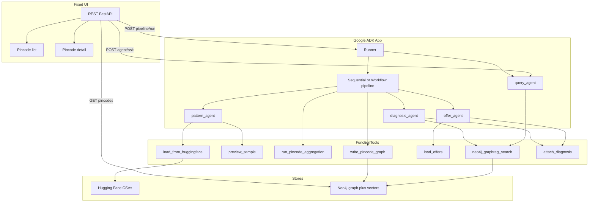
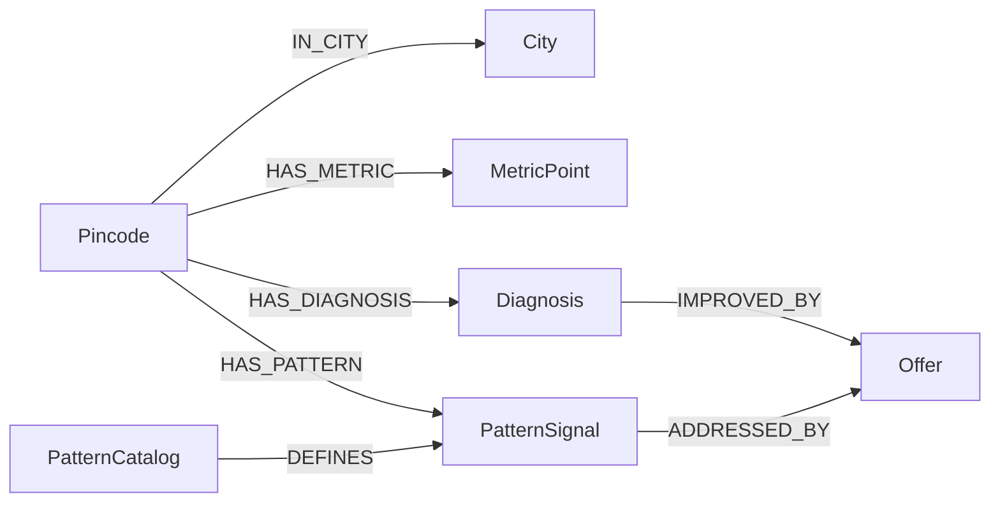

# Churn diagnosis by pincode (new approach)

## What changes vs today

Today ([`app/pipeline/load.py`](app/pipeline/load.py)): join **local** `DataSet/` CSVs → Postgres → LLM/heuristic **column recipe** → city vs rest-of-state gaps → scorecards → Neo4j `(:City)-[:HAS_GAP]->(:Gap)` with hash embeddings. Offers are planned but not built; grain is **city**.

New approach — **agentic by default (Google ADK)**:

The product is an **ADK multi-agent App**, not a plain script with a chat bolted on. Imperative code exists only as **tools** agents call. Orchestration uses ADK [Sequential / Workflow / Loop / Parallel agents](https://adk.dev/agents/workflow-agents/sequential-agents/index.md) and [graph workflows](https://adk.dev/graphs/index.md) where stages must not be skipped ([ADK 2.0](https://adk.dev/2.0/index.md)).

0. **Ingest tools** — HF fetch + join (agents call tools; no local `DataSet/` as source of truth).
1. **`pattern_agent` (LLM)** — designs the churn pattern catalog from headers + sample tool output.
2. **Aggregate tool (pandas)** — deterministic pincode aggregation; agents invoke it, never recompute rates in prose.
3. **Graph tools + GraphRAG** — write Neo4j mappings; retrieve via [`neo4j-graphrag` + ADK](https://neo4j.com/labs/genai-ecosystem/genai-frameworks/google-adk/).
4. **`diagnosis_agent` / `offer_agent` (LLM)** — reason over aggregates + GraphRAG; persist via tools.
5. **`query_agent` (LLM)** — optional semantic Q&A over the graph for backend `/agent/ask`.
6. **Fixed UI** — Next.js list/detail over REST; triggers the agentic pipeline; **no CopilotKit generative UI**.

**Accuracy rule (non-negotiable):** Numbers come only from pandas/Neo4j tools. LLM agents choose *what to measure* and *how to explain/assign offers*; they never invent aggregates from raw CSV.



---

## Agentic architecture (Google ADK)

### App shape

- Single ADK `App` (replace today’s CopilotKit/`generateSandboxedUi` coordinator in [`app/agents/runtime.py`](app/agents/runtime.py)).
- Model: existing Azure OpenAI via `LiteLlm` ([ADK LiteLLM](https://adk.dev/agents/models/litellm/index.md)).
- `ReflectAndRetryToolPlugin` so tool/Cypher failures can be retried ([Neo4j Labs ADK pattern](https://neo4j.com/labs/genai-ecosystem/genai-frameworks/google-adk/)).
- Session state holds: `catalog`, `aggregate_path` / profiles summary, `pipeline_status`, last errors.

### Pipeline workflow (deterministic spine)

Use a **SequentialAgent** or ADK **Workflow** so stages cannot be skipped:

1. Call `load_from_huggingface` → `preview_sample`
2. Run `pattern_agent` → validate catalog JSON (`validate_catalog` tool)
3. Call `run_pincode_aggregation` with catalog
4. Call `load_offers` + `write_pincode_graph`
5. **Loop / Parallel** over priority pincodes (e.g. top-N by churn/gap): `diagnosis_agent` → `offer_agent` → `attach_diagnosis`

LLM specialists sit *inside* steps; tools do I/O and math.

### Specialist agents

| Agent | Role | Tools |
|-------|------|-------|
| `pattern_agent` | Infer churn/dissatisfaction fields and composite patterns | `preview_sample`, `list_columns`, `validate_catalog` |
| `diagnosis_agent` | Explain what is lacking in a pincode using facts only | `get_pincode_profile`, `neo4j_graphrag_search` |
| `offer_agent` | Map diagnosis to menu `offer_id` only | `load_offers`, `attach_diagnosis` |
| `query_agent` | Answer sales questions from the graph | `neo4j_graphrag_search`, `get_pincode_profile` |

Optional root **router** agent: “run pipeline” vs “ask about a place” → pipeline workflow vs `query_agent`.

### What stays non-agentic (by design)

- Pandas groupby math, HF download bytes, Neo4j index DDL — pure Python inside tools.
- Fixed UI rendering — React components reading REST JSON.

### What becomes agentic (maximize)

- Choosing patterns and metrics (catalog).
- Diagnosing areas and assigning offers.
- Deciding which zips to prioritize / how to use GraphRAG context.
- Answering free-text questions via `query_agent`.
- Orchestrating the full run through ADK Runner (triggered by UI/API), not a standalone `load.py` script as the brain.

---

## Why Neo4j vector indexes matter (in this product)

Graph relationships alone answer *structural* questions: “What metrics hang off zip 90001?” / “Which offer improves this diagnosis?” That needs exact keys (`zip`, `metric`, `offer_id`).

Sales users and the LLM ask *semantic* questions: “Where are people paying for extra data without unlimited?” / “Which areas look like Los Angeles on retention?” Exact Cypher property match fails here because wording does not equal column names.

**Vector indexes close that gap:**

1. **Meaning-based entry point** — Embed the question; `db.index.vector.queryNodes` finds `MetricPoint` / `PatternSignal` / `Diagnosis` / `Offer` nodes whose `sentence` is closest in meaning, even when the user never says `zip_code` or `unlimited_data`.
2. **Grounded RAG** — Hits are real stored facts (numbers from pandas), not free-form model memory. The agent then **walks the graph** from the hit to the `Pincode`, sibling metrics, diagnosis, and assigned offer — structure + semantics together.
3. **Scale** — Thousands of metric nodes across ~1.6k zips cannot be dumped into the LLM context. The index returns a small top-k set; traversal adds only the needed neighborhood.
4. **Cross-entity discovery** — Same question can surface a pattern node, a similar zip’s diagnosis, or a matching offer blurb because each label has its own vector index on semantic text.
5. **ADK GraphRAG** — per the [Neo4j Google ADK guide](https://neo4j.com/labs/genai-ecosystem/genai-frameworks/google-adk/), `neo4j-graphrag` retrievers use these indexes so a natural-language question returns text **plus** related entities via a `retrieval_query` Cypher expansion.

Without vector indexes, Neo4j is only a keyed lookup store. With them (and GraphRAG), it becomes the agent’s **searchable memory** over area facts while relationships keep answers accurate and navigable.

---

## Master prompt (use as the product / agent spec)

Copy-ready specification for implementation and for LLM system prompts.

---

### Role

You are designing and running an **area-level telco churn and dissatisfaction diagnosis pipeline** for sales and marketing. The goal is to answer: *What is driving churn or dissatisfaction in this pincode, and which retention / upsell offer should we push there?* Never recommend actions for a single named customer in the primary output; individuals appear only inside aggregates or as anonymous pattern examples.

### Data source — Hugging Face (not local DataSet)

**Dataset:** [bless2504/aadityabansalcodes_telecommunications-industry-customer-churn-dataset](https://huggingface.co/datasets/bless2504/aadityabansalcodes_telecommunications-industry-customer-churn-dataset/tree/main)

Do **not** require checked-in CSVs under `DataSet/`. At pipeline start, fetch the CSV files from the Hub (Hub API / `huggingface_hub`), then join in memory with the same logic as today’s loader.

**Files to download (CSV only; ignore `.xlsx` duplicates):**

| File | Role |
|------|------|
| `Telco_customer_churn_demographics.csv` | Age, household |
| `Telco_customer_churn_services.csv` | Phone, internet, contract, charges, current offer |
| `Telco_customer_churn_status.csv` | Status, satisfaction, churn labels/reasons |
| `Telco_customer_churn_location.csv` | City, zip, lat/long |
| `Telco_customer_churn_population.csv` | Population by zip |
| `Telco_customer_churn.csv` | Optional wide-file fallback if splits missing |
| `CustomerChurn.csv` | Not used by the join path (same as today) |

**Fetch mechanism (concrete):**

- Dependency: `huggingface_hub`.
- Prefer `hf_hub_download(repo_id=..., repo_type="dataset", filename=...)` per required CSV, or `snapshot_download` with `allow_patterns=["*.csv"]`.
- Default `repo_id`: `bless2504/aadityabansalcodes_telecommunications-industry-customer-churn-dataset`.
- Hub caches under the standard HF cache (or `HF_HOME` / `HF_HUB_CACHE`); optional app-level `HF_CACHE_DIR` for clarity.
- Optional `HF_TOKEN` if the dataset or rate limits ever require auth; public read works without a token today.
- On failure (network / 404): fail the pipeline with a clear error — do not silently fall back to a local `DataSet/` tree for the happy path.
- Replace [`load_directory`](app/analysis/loader.py) entrypoint with something like `load_from_huggingface()` that downloads → then reuses existing join / `_row_from_parts`.

**After join:** same canonical fields as today (`customer_id`, `city`, `state`, `zip_code`, `population`, services, churn fields, etc.). Do **not** use `gender` for targeting. Treat IDs and lat/long as non-features.

**Offers menu** is **not** on Hugging Face — keep a small local seed file (e.g. `app/data/offers.csv`) owned by this app.

### Stage 0 — Fetch CSVs from Hugging Face (ADK tools)

**When:** ADK pipeline workflow step (triggered by `POST /pipeline/run` or startup Runner).

**Tools:** `load_from_huggingface`, `preview_sample`, `list_columns`.

**Steps (invoked by the workflow / ingest agent, not ad-hoc scripts):**

1. Resolve `HF_DATASET_ID` (default above).
2. Download each required CSV into the HF cache.
3. Join → customer `DataFrame` in process / artifact store; put summary in session state.
4. Record in pipeline status: `dataset_id`, filenames fetched, row counts, cache hit vs download.

### Stage 1 — `pattern_agent` (LLM specialist)

**Input via tools (small):**

- Full list of column names and short descriptions if available (`list_columns`).
- About **5–10 sample rows** from `preview_sample` (anonymized; drop or hash `customer_id` if shown).
- Optional: value histograms for low-cardinality columns (distinct counts, top values) so the model understands domains without seeing the full file.

**Task for `pattern_agent`:** Produce a machine-readable **Churn Pattern Catalog** (JSON) that answers:

1. Which columns are useful for identifying **customer churn** or **dissatisfaction** (and which to ignore).
2. For each kept column: role (`outcome`, `driver`, `segment`, `context`), suggested summary method (`share`, `mean`, `distribution`, `top_values`, `rate`, `ratio`), and why it matters for churn.
3. **Composite patterns** — multi-field hypotheses the aggregator must compute, e.g.:
   - High churn rate among month-to-month + fiber + no unlimited data.
   - Low satisfaction correlated with high extra data charges.
   - Share of churn reason = “Competitor” vs “Attitude” / “Dissatisfaction” / “Price”.
4. **Baseline definition** for comparisons: default **this pincode vs all other pincodes in the same state** (California in this dataset).
5. **Minimum support:** flag groups with `n < MIN_N` (default 30) as thin; do not treat thin gaps as confident.

**Hard constraints for Stage 1:**

- Model must not invent columns that are not in the header list.
- Model must not compute statewide statistics itself from the sample; sample is for schema and pattern *design* only.
- Output schema must be strict JSON so pandas can execute it without ambiguity (column → action → optional filters → output metric name).

**Expected JSON shape (illustrative):**

```json
{
  "place_key": "zip_code",
  "baseline": "rest_of_state",
  "outcomes": [
    {"field": "customer_status", "positive_values": ["Churned"], "metric": "churn_rate", "method": "share"}
  ],
  "drivers": [
    {"field": "unlimited_data", "method": "share", "focus_value": "No", "reason": "..."},
    {"field": "contract", "method": "distribution", "reason": "..."}
  ],
  "patterns": [
    {
      "id": "heavy_usage_no_unlimited",
      "description": "Internet users with high GB and no unlimited plan",
      "filters": {"internet_service": "Yes", "unlimited_data": "No"},
      "metrics": [{"field": "avg_monthly_gb", "method": "mean"}, {"field": "churn_rate", "method": "share"}]
    }
  ],
  "ignore": ["customer_id", "gender", "latitude", "longitude"]
}
```

### Stage 2 — `run_pincode_aggregation` tool (pandas, no Postgres)

**Invoked by the ADK pipeline after catalog validation** — not by free-form LLM math.

**Input:** Full joined DataFrame from Stage 0 + validated catalog from session state (reuse join / `_row_from_parts` in [`app/analysis/loader.py`](app/analysis/loader.py)).

**Process inside the tool:**

1. Parse catalog into executable metric specs.
2. `groupby("zip_code")` (keep `city` / `state` / `population` attributes).
3. For every outcome, driver, and composite pattern: pincode value, rest-of-state baseline, delta, `n`, gap score (spirit of [`app/analysis/aggregate.py`](app/analysis/aggregate.py)).
4. Emit rich per-pincode profiles; store artifact + session pointer for later agents.

**Hard constraints:**

- Deterministic and complete vs catalog; no LLM inside groupby; no CSV subsample; unit-testable.

### Stage 3 — Neo4j: location ↔ datapoint graph with vectors

Neo4j is the **system of record for mappings** between a location and its computed datapoints, diagnoses, and offers. Aggregation stays in pandas; **storage, relationships, and LLM retrieval** go through Neo4j (extend [`app/storage/graph.py`](app/storage/graph.py)).

#### Graph model (pincode-centric)



**Node types and properties:**

| Label | Key props | Semantic text (`sentence`) | Vector |
|-------|-----------|----------------------------|--------|
| `Pincode` | `zip`, `city`, `state`, `n`, `population`, `churn_rate`, thin flags | Short place summary (“Zip 90001 in Los Angeles, n=42, churn 28% vs state 19%…”) | Yes — place overview index |
| `MetricPoint` | `metric`, `value`, `baseline`, `delta`, `gap_score`, `n`, `unit` | Natural-language fact for that metric at that zip | Yes — metric fact index |
| `PatternSignal` | `pattern_id`, pattern metrics JSON, `gap_score` | Description of the composite pattern and local numbers | Yes |
| `Diagnosis` | `problem`, `confidence`, `evidence` JSON | Full diagnosis paragraph for the area | Yes |
| `Offer` | `offer_id`, `name`, `description`, `tags` | Offer blurb + which problems it addresses | Yes |
| `PatternCatalog` / `City` | catalog version / city name | Optional; city mainly for grouping | Catalog text optional |

**Relationships (the “mappings”):**

- `(:Pincode)-[:IN_CITY]->(:City)`
- `(:Pincode)-[:HAS_METRIC]->(:MetricPoint)` — every computed datapoint linked to its location
- `(:Pincode)-[:HAS_PATTERN]->(:PatternSignal)`
- `(:Pincode)-[:HAS_DIAGNOSIS]->(:Diagnosis)`
- `(:Diagnosis)-[:IMPROVED_BY]->(:Offer)` — assigned offer for that area’s problem
- `(:PatternSignal)-[:ADDRESSED_BY]->(:Offer)` — offer menu tags resolved to graph edges where possible
- Optional: `(:MetricPoint)-[:STRONGER_THAN|:WEAKER_THAN]->(:MetricPoint)` only if needed later; not required for v1

**Vector indexes + GraphRAG (ADK integration):**

- Create Neo4j vector indexes (cosine) on semantic nodes (`MetricPoint`, `PatternSignal`, `Diagnosis`, `Offer`; optional `Pincode`). Optional full-text indexes if using `HybridCypherRetriever`.
- On write: deterministic English `sentence` from structured props → embed with the **same embedder** that GraphRAG will use at query time (critical pairing per Neo4j Labs; mismatch fails silently). Prefer a real embedder compatible with `neo4j-graphrag` (e.g. SentenceTransformer or Azure) over hash BoW for production quality.
- On query: do **not** hand-roll only raw `db.index.vector.queryNodes`. Follow [Google ADK + Neo4j](https://neo4j.com/labs/genai-ecosystem/genai-frameworks/google-adk/) pattern **Semantic Retrieval via `neo4j-graphrag`**:
  - `HybridCypherRetriever` (or `VectorCypherRetriever`) with a `retrieval_query` that expands from the hit node to `Pincode`, sibling metrics, `Diagnosis`, and `Offer`.
  - Wrap `retriever.search(...)` in an ADK `FunctionTool` so the Google ADK agent calls GraphRAG like any other tool.
  - Optional later: Neo4j MCP (`get-schema` / `read-cypher`) for introspection — not required for v1 if GraphRAG + REST cover the UI.

**Write path after pandas:**

1. Clear or version-replace the churn subgraph for a reload.
2. Upsert all `Offer` nodes from `offers.csv`.
3. For each pincode profile: create `Pincode` + `HAS_METRIC` / `HAS_PATTERN` nodes with sentences + embeddings.
4. After Stage-4 diagnosis: attach `Diagnosis` and `IMPROVED_BY` → `Offer`.

**Hard constraints for Stage 3:**

- Every number on a graph node must come from the pandas aggregate (or offer file) — no LLM-written metrics into the graph.
- Semantic `sentence` is a deterministic template from those numbers (so retrieval stays grounded).
- Graph is the place the LLM looks up “what do we know about zip X / unlimited data gaps / which offer fixes pattern Y”.

### Stage 4 — `diagnosis_agent` + `offer_agent` (+ GraphRAG tools)

**Workflow step:** Loop/Parallel over priority pincodes after graph write.

**Per zip, agents use tools:**

1. `get_pincode_profile` — aggregate numbers only.
2. `neo4j_graphrag_search` — similar patterns / neighbor context ([Labs GraphRAG as ADK tool](https://neo4j.com/labs/genai-ecosystem/genai-frameworks/google-adk/)).
3. `load_offers` — menu only.
4. `attach_diagnosis` — persist diagnosis + `IMPROVED_BY`.

**JSON output:** problem, evidence (cite tool numbers only), confidence, `offer_id` or null, optional secondary offer.

**`query_agent`:** same GraphRAG + profile tools for `POST /agent/ask` (backend agentic Q&A; UI can ignore or add a simple ask box later that posts to this endpoint — still fixed UI, not generative HTML).

**Hard constraints:** menu-only offers; no fabricated stats; thin sample → null offer.

### Stage 5 — Fixed UI in `geo-analysis-ui` (in scope)

**Location:** [`geo-analysis-ui`](../geo-analysis-ui)

**Remove CopilotKit generative UI** (Open Generative UI, sandbox, `/api/copilotkit`, `generateSandboxedUi`). UI is fixed React + REST.

**Screens (frontend design skill):**

1. Briefing list — zip, city, problem, vs baseline, headcount, offer.
2. Detail — diagnosis, evidence, confidence, offers, patterns.
3. Status — pipeline state; button to `POST /pipeline/run` (starts ADK Runner).

**APIs:** `GET /pipeline/status`, `GET /patterns`, `GET /pincodes`, `GET /pincode/{zip}`, `POST /pipeline/run`, optional `POST /agent/ask`.

---

## Implementation plan

### A. Backend — ADK-first (`geo-analysis-backend`)

- Rebuild [`app/agents/`](app/agents/) as the product core: `App`, pipeline Sequential/Workflow, specialists, tools module, Runner wired from FastAPI.
- Tools implement HF, pandas agg, Neo4j write, offers, GraphRAG (`neo4j-graphrag`).
- Retire imperative [`app/pipeline/load.py`](app/pipeline/load.py) as the brain (keep helpers if useful inside tools).
- Remove CopilotKit/`ag-ui-adk` generative path.
- Deps: `google-adk>=2`, `neo4j-graphrag`, `huggingface_hub`, `pandas`.

### B. Frontend (`geo-analysis-ui`)

- Fixed list/detail; trigger agentic pipeline via REST; frontend design skill; no generative UI.

### C. De-emphasize

- Local `DataSet/`, Postgres mappings, city-only grain, CopilotKit generative UI, non-agent scripted orchestration.

### D. Tests

- Tool unit tests (HF mock, pandas exactness, Neo4j write).
- Agent smoke: Runner completes pipeline with mocked LLM or recorded fixtures where needed.
- GraphRAG smoke: question → relevant pincode/offer.

### E. Config

`HF_*`, `OFFERS_PATH`, `ARTIFACTS_DIR`, Neo4j, Azure/LiteLLM, embedder aligned with GraphRAG. UI `API_URL` → `localhost:8000`.

---

## Delivery order

1. ADK App skeleton + tool stubs + FastAPI `POST /pipeline/run` / status.
2. HF + join tools; offers seed tool.
3. `pattern_agent` + catalog validation.
4. Pandas aggregation tool (+ tests).
5. Neo4j write + vector indexes; GraphRAG ADK tools.
6. `diagnosis_agent` / `offer_agent` loop; `query_agent` + optional `/agent/ask`.
7. Fixed `geo-analysis-ui` list/detail wired to REST + run pipeline.
